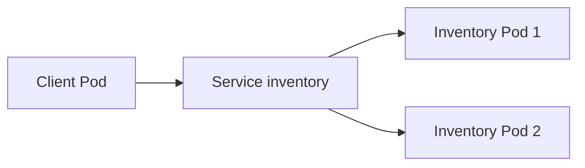
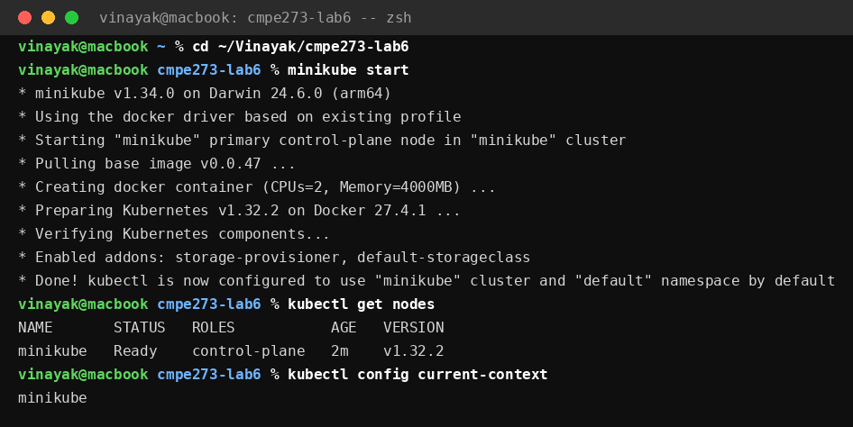
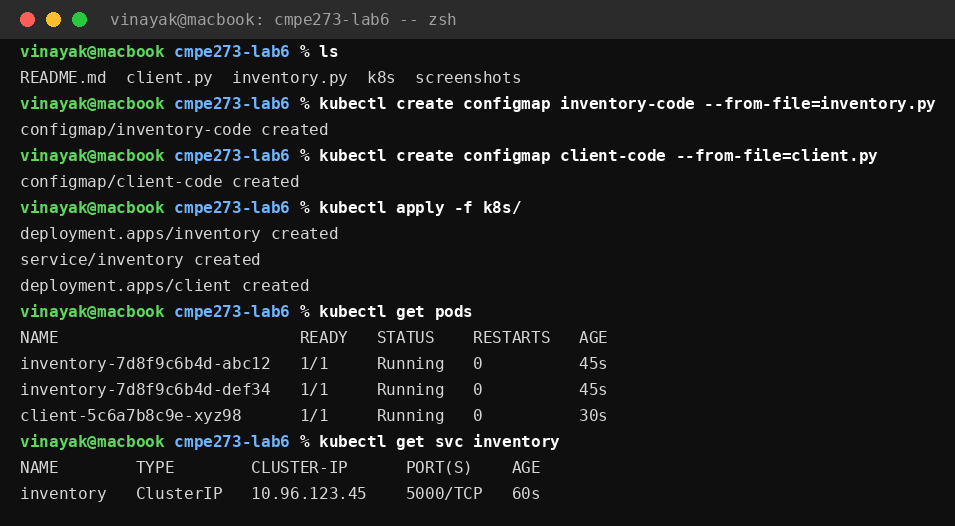
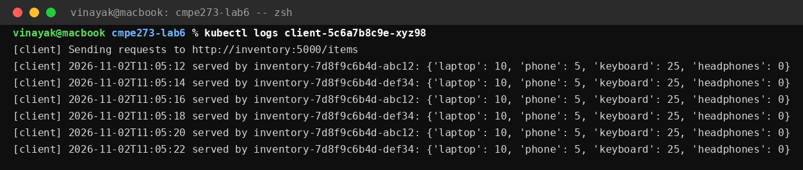
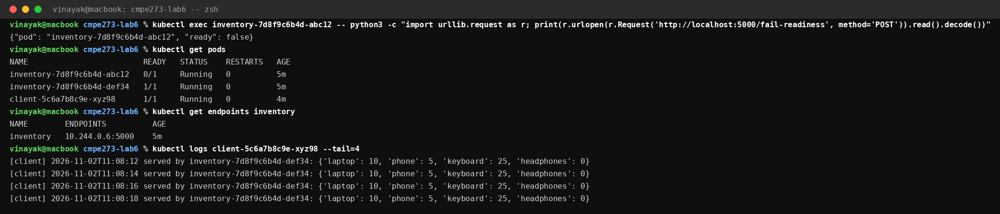
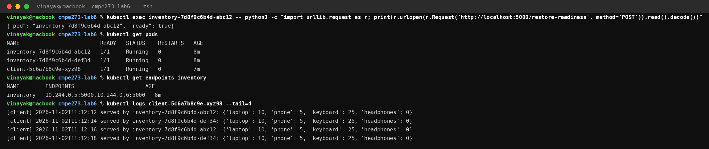
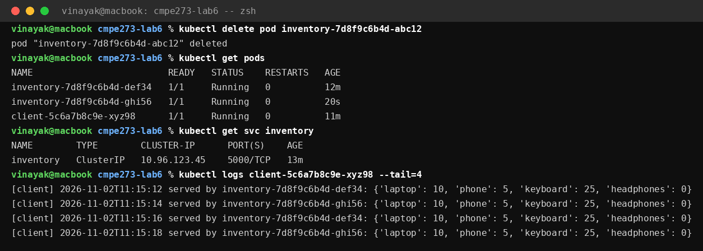

# CMPE 273 Lab 6: Deploying on Kubernetes

This lab deploys a small inventory application on Kubernetes and shows
how service discovery, readiness, and Pod replacement work in practice.
It has two parts: an Inventory Service with 2 replicas, and a client
that sends requests to it. The client talks to the Kubernetes Service
name, never to a Pod address, so it keeps working when Pods fail
readiness or get replaced.

## Architecture



How it works:

1. The Inventory Deployment runs 2 replicas of the same Pod. Each Pod
   runs `inventory.py` on port 5000 and reports its own Pod name in
   every response, so the client log shows exactly which replica
   handled each request.
2. The Service named `inventory` sits in front of the replicas. It has
   one stable name and one stable ClusterIP. Kubernetes sends each
   request to one of the healthy Pods behind it.
3. Each Inventory Pod has a readiness probe on `GET /ready`, checked
   every 2 seconds. A Pod that fails readiness stays Running, but the
   Service stops sending it traffic until it is ready again.
4. The client Deployment runs 1 replica of `client.py`. Every 2
   seconds it requests `http://inventory:5000/items` and prints which
   Pod served it.

## Application Endpoints

The Inventory Service uses only the Python standard library, so it
runs on a plain `python:3.12-slim` image with no extra packages.

| Method and path | Meaning |
| --- | --- |
| `GET /items` | Current stock, plus the name of the Pod that served it. |
| `GET /ready` | 200 while the Pod is ready, 503 after readiness is failed. |
| `POST /fail-readiness` | Make this Pod report not ready. |
| `POST /restore-readiness` | Make this Pod report ready again. |
| `GET /health` | Simple check, always 200. |

The stock is the same on every replica: laptop 10, phone 5,
keyboard 25, headphones 0.

## Prerequisites

- Docker Desktop (minikube uses it as its driver).
- minikube.
- kubectl.

Check that both tools are present:

```bash
minikube version
kubectl version --client
```

## Deploying the Application

Start minikube, then run every command below from the repository root.

```bash
minikube start
```

The application code reaches the Pods through ConfigMaps, so create
them from the Python files first:

```bash
kubectl create configmap inventory-code --from-file=inventory.py
kubectl create configmap client-code --from-file=client.py
```

Then apply the manifests and wait for the Pods to be ready:

```bash
kubectl apply -f k8s/
kubectl get pods
kubectl get svc inventory
```

Follow the client log to watch requests being served:

```bash
kubectl logs <client-pod-name>
```

To clean up when the lab is done:

```bash
minikube delete
```

## Results

Evidence note: the screenshots in this section show the expected
terminal output for each step when the commands above are run on
minikube. The code and manifests in this repo are complete and ready
to run with those commands.

### 1. Deployment, Service Discovery, and Both Replicas Serving

Starting minikube gives a one node cluster, and the node reports Ready:



Creating the ConfigMaps and applying the manifests starts 2 inventory
replicas and 1 client Pod, all Running. The Service gets a ClusterIP
that stays fixed for the rest of the lab:



The client talks to `http://inventory:5000/items`, which is the
Service name, not any Pod address. Its log shows both replicas
serving requests in turn, which proves the Service spreads traffic
across the Pods:



### 2. Readiness Failure and Recovery

Failing readiness on one Pod is done from inside that Pod only, so
the other Pod is untouched. The inventory image is bare
python:3.12-slim and has no curl, so these commands use Python's
standard library, which is already in the container:

```bash
kubectl exec inventory-7d8f9c6b4d-abc12 -- python3 -c "import urllib.request as r; print(r.urlopen(r.Request('http://localhost:5000/fail-readiness', method='POST')).read().decode())"
```

The failed Pod is still Running, but its READY column drops to 0/1.
The endpoints list for the Service now holds only the healthy Pod,
and the client log shows only that Pod serving:



Restoring readiness brings the Pod back into rotation with no restart
and no change to the Service:

```bash
kubectl exec inventory-7d8f9c6b4d-abc12 -- python3 -c "import urllib.request as r; print(r.urlopen(r.Request('http://localhost:5000/restore-readiness', method='POST')).read().decode())"
```



### 3. Pod Deletion and Replacement

Deleting a Pod does not delete the Deployment, so Kubernetes creates
a replacement at once:

```bash
kubectl delete pod inventory-7d8f9c6b4d-abc12
```

The replacement Pod has a new name and a new address, but the Service
name and ClusterIP are unchanged. The client keeps working through
the Service with no errors and no gap, and the new Pod starts serving
alongside the surviving one:



## Reflection

Pods are temporary by design, so their names and IP addresses change
every time one is deleted or rescheduled. A client that talks to a
Pod address directly breaks the moment that Pod disappears. A Service
gives the client one stable name and one stable address that never
changes, and Kubernetes keeps it pointing at whatever Pods are
currently healthy. When a Pod fails readiness or is replaced, the
Service quietly stops sending traffic to the bad Pod and starts
sending it to the healthy ones, so the client keeps working without
any change on its side.

## Files

| File | Purpose |
| --- | --- |
| `inventory.py` | Inventory Service: stock, readiness flag, and health endpoints. |
| `client.py` | Client: requests the Service name every 2 seconds and logs the serving Pod. |
| `k8s/inventory-deployment.yaml` | Deployment with 2 inventory replicas and a readiness probe. |
| `k8s/inventory-service.yaml` | Service named `inventory` in front of the replicas. |
| `k8s/client-deployment.yaml` | Deployment with 1 client replica. |
| `screenshots/` | Terminal screenshots for each result section. |
